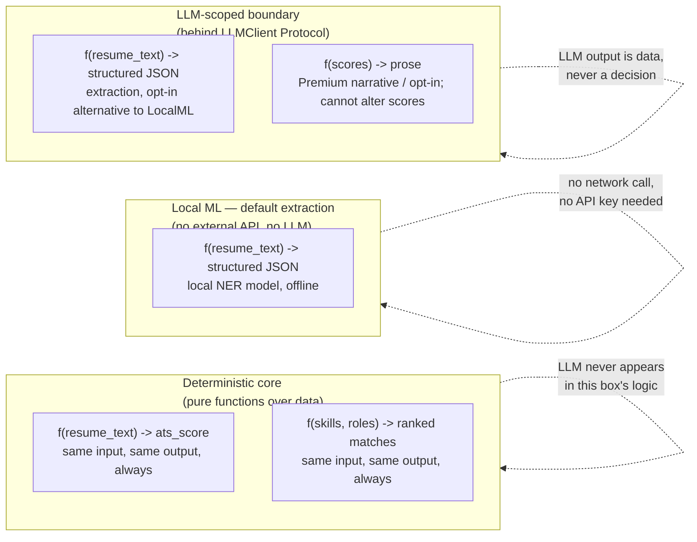
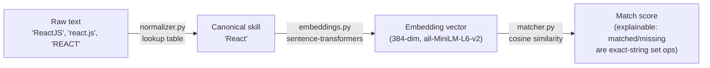
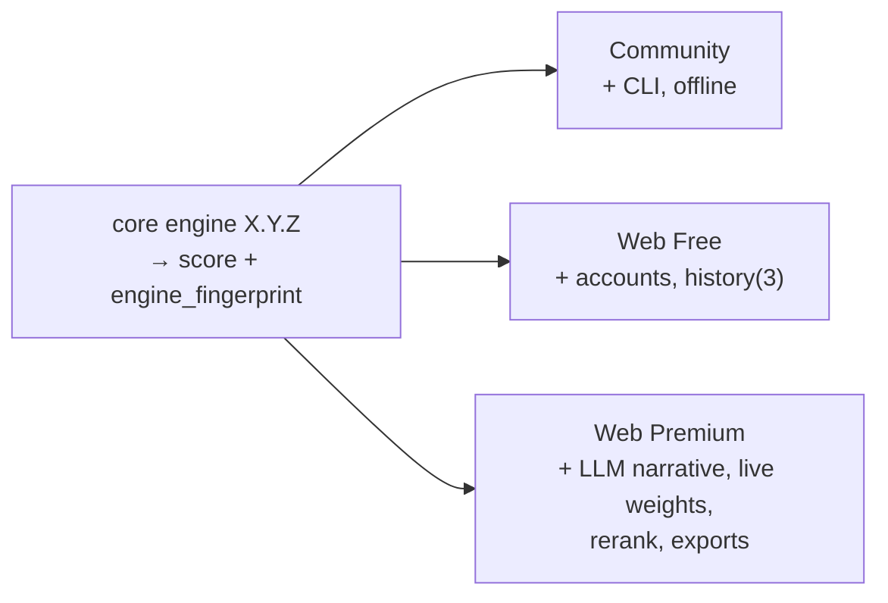

# Abstraction overview

This page sits above [Architecture](architecture.md) and [HLD](hld.md). It describes the abstractions the system is built from: the boundaries that let each piece be reasoned about, tested and extended on its own. They explain why the codebase is organized the way it is.

## 1. The market gap this project targets

Per the SRS (§1.4, §2.1), this project fills a specific gap in comparable systems:

- Recruiter-facing AI screening platforms (HireVue, Eightfold AI, iCIMS) solve a different problem for a different user: employers screening candidates at scale. This project serves a candidate improving their own materials.
- Academic "resume analyser" projects typically wrap a single chat-style LLM prompt around the entire task. That gives one pass, no reproducibility (ask twice, get two different scores), no explainability (no way to point at why a number is what it is), and no way to improve as the job market changes. "An AI-Driven Resume Analyser with Job Recommender and Portfolio Code Generator" (IJRASET, April 2026), which the SRS cites as the direct point of comparison, documents this limitation explicitly.

- Open-source self-hosted resume tools (Resume-Matcher, Reactive Resume, OpenResume) either have no product tiers at all, or let their score depend on whichever LLM each user configured, so two installations never agree.

This system answers with three abstractions, described below: a boundary between the deterministic core and a narrow LLM role; a temporal, versioned weight store in place of a static one; and one core-engine artifact shared by every edition, so a self-hosted run and the hosted free tier are provably the same computation.

## 2. Abstraction 1: the deterministic core / LLM boundary

The system has three kinds of computation. Between the deterministic core and the LLM sits a local ML model, which handles structured extraction without hand-written rules or an external API:



The code enforces the boundary in two ways:

1. Module boundary. `normalizer.py`, `matcher.py`, `ats_score.py`, and `gap_analysis.py` have zero imports of `llm_client.py`, `local_ner_parser.py`, or any LLM/NER SDK. `explainer.py` is the only module that unconditionally touches an `LLMClient`; `parser.py` touches `local_ner_parser.py` by default and `llm_client.py` only when `PARSER_BACKEND=llm`.
2. Interface boundary. `LLMClient` is a `typing.Protocol`: `parser.py`'s opt-in path and `explainer.py` depend on an abstract `.complete(system_prompt, user_prompt) -> str` shape, not on a concrete SDK's types (`GroqLLMClient`/`GeminiLLMClient` both implement it). That lets the test suite (`tests/test_pipeline.py`, `tests/test_llm_client.py`) substitute a `FakeLLMClient` and run fully offline. `local_ner_parser.py` uses the same seam at a smaller scale: `parse_resume_local()` takes an injectable pipeline callable, so its entity-clustering logic (`tests/test_local_ner_parser.py`) is testable without downloading the real model either.

The point of the boundary is that the cost of using an LLM (non-determinism, latency, external dependency, price) is paid only where a user has chosen it: the Premium narrative or the opt-in extraction path. With the planned `TemplateExplainer` as the default (step 1), the deterministic core plus the local NER model produce a complete result with no network and no API key. That is the precondition for the Community Edition and for result parity with Web Free. The boundary is strict because of research on LLM judges (see [Editions & Parity §6](editions-and-parity.md#6-research-behind-the-design)): identical resumes get different scores from the same model even at temperature 0, and three LLMs disagreed on 39 % of resumes.

## 3. Abstraction 2: skills as a normalized, versioned vector space

All skill data goes through one canonical representation before anything is compared:



Two sub-abstractions stack here:

- Canonicalization (`normalizer.py`) collapses spelling and casing variants before anything numeric happens, so matched/missing-skill lists stay exact and human-readable instead of becoming fuzzy embedding distances.
- Vectorization (`embeddings.py`) is the only place where floating-point, model-dependent computation enters the pipeline. It sits behind two functions (`embed`, `cosine_similarity`), so the model can be swapped without touching `matcher.py`'s ranking logic. Planned for step 2: because the matcher only sees canonical skills, every skill and role vector is computed once at build time and shipped as a constant table (`skill_vectors.npy`, `role_vectors.npy`), and the model runs only for out-of-taxonomy skills. Constant vectors cannot drift between CPUs, and the remaining cosine arithmetic is rounded to two decimals before ranking, with a deterministic tie-break.

Temporal extension (implemented in the backend; the matcher reading it is planned). The `skill_vectors` table (see [Database Schema](database-schema.md)) is a versioned, time-decayed store. Each role's weights are updated by EMA (`new_weight = α·new_signal + (1−α)·old_weight`) as feedback arrives, and every prior version is kept. Step 3 closes the loop: the backend exports the current weights as a hashed snapshot, the matcher uses a weighted mean, and the snapshot ships inside every edition's engine artifact. An offline Community user therefore gets weights learned from web feedback, and Web Free stays byte-comparable with Community because both read the same frozen snapshot. Only Web Premium may use live weights, and the response says so when it does.

## 4. Abstraction 3: file format behind an adapter interface

`POST /parse-file` turns a resume file (PDF today, other formats later) into the same plain text the rest of the pipeline already consumes. The router holds no PDF-specific logic. That job sits behind `DocumentTextExtractor` (`document_extraction/base.py`), a `typing.Protocol` with one method (`extract(file_bytes) -> str`), implemented today by `PdfTextExtractor` and picked by file extension in `registry.py`.

```mermaid
flowchart LR
    router["upload.py\nPOST /parse-file"] -->|file bytes, filename| registry["registry.py\nget_extractor_for_filename()"]
    registry -->|".pdf"| pdf["PdfTextExtractor\n(pdfplumber, column-aware)"]
    registry -.->|".docx" (not yet registered)| future["future DocxTextExtractor"]
    pdf -->|text, correct reading order| parser["parser.py\n(unchanged)"]
```

This is the same interface-boundary pattern as `LLMClient` (Abstraction 1), one layer earlier in the pipeline. A new file format means one new class that implements `DocumentTextExtractor` and one line in the registry's dictionary; `routers/upload.py` and everything after text extraction stay the same. It also keeps the PDF-specific complexity (detecting and correcting for multi-column layouts, so a resume's sections don't get interleaved before parsing sees the text) inside `pdf_extractor.py`, invisible to the rest of the system. The pattern is a standing project rule; see `CLAUDE.md`, "Design principles".

## 5. Abstraction 4b: one engine, three editions

The product ships as a Community Docker image, a hosted Free tier and a hosted Premium tier. All three run one core-engine artifact (code, pinned models by content hash, taxonomy, vector tables, weights snapshot, ATS rules, template explainer), so there are no separate codebases or configurations to drift apart. Each edition is that artifact plus a layer that adds features around the score:



Three rules, each enforced mechanically, keep the editions identical:

1. Nothing on the score path is downloaded or called at runtime. The Community image runs with `--network none`, and CI proves it.
2. Every response carries `engine_fingerprint`, so a user can compare their local run with `GET /health` on the web and know whether the same engine produced both.
3. A golden suite runs inside the Community image and against the deployed Web Free API before every release; a single differing byte blocks the tag.

Premium features are additive fields (`explanation_source: "llm"`, a rerank list, a `weights: "live"` disclosure) on top of the identical base result. SonarQube, Semgrep and Plane use the same shape for their Community-vs-paid split; [Editions & Parity](editions-and-parity.md) has the details and sources.

## 6. Abstraction 5: layered request handling

A standard layered separation. It is what keeps the ML service testable without a running server or database:

| Layer | Knows about | Does not know about |
|---|---|---|
| Router (`routers/analyze.py`, `routers/upload.py`) | HTTP request/response shapes (Pydantic models), which service to call | How any service computes its result |
| Service (`services/*.py`) | Its one job (parse, normalize, match, score, explain) | HTTP, FastAPI, request/response wrapping |
| Schema (`models/schemas.py`) | Field names, types and defaults (the data contract) | Any business logic |
| Data (`data/*.json`, planned DB) | Static/persisted values | How they're used |

As a result, every service function in `ml-service/app/services/` can be called directly in a test with plain Python values, without a FastAPI `TestClient` or an HTTP round-trip. `tests/test_ats_score.py`, `test_matcher.py` and `test_normalizer.py` all import and call service functions this way.

## 7. Where the abstractions end and the roadmap begins

The abstractions above hold for what's built (`ml-service/`, `backend/`, `frontend/`). What remains, in the order of [Editions & Parity §7](editions-and-parity.md#7-implementation-order):

- Explainer seam and pinned models (step 1): `TemplateExplainer` as default, HF revisions pinned and exported to ONNX, 2-dp rounding, `engine_fingerprint`.
- Pipeline restaging (step 2): sectioner, dictionary skills, NER scoped to two sections, precomputed vector tables. This is the change that makes a 2-core / 4 GB PC enough.
- Snapshot contract (step 3): the file boundary between the backend's learned weights and the engine's matcher.
- Community packaging (step 4), tier gating (step 5), golden parity CI (step 6), training pipeline (step 7).
- Persistence abstraction (later): `normalizer.py` and `matcher.py` still read JSON files; admin-editable taxonomy (FR-2.3) and the ESCO migration move them behind a repository interface, still exported to files for the engine artifact.
- File-format coverage (later): only `PdfTextExtractor` exists; DOCX is one adapter away.

## Related documents

- [System Architecture](architecture.md) · [Editions & Parity](editions-and-parity.md)
- [High-Level Design](hld.md) · [UML Diagrams](uml-diagrams.md) · [Entities & Fields](entities-and-fields.md) · [SRS v2.0](srs.md)
