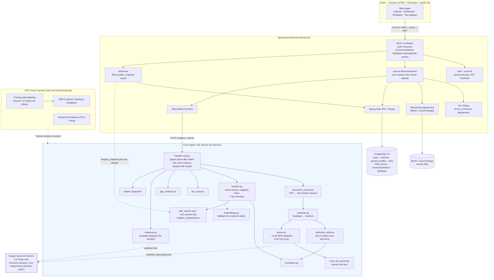
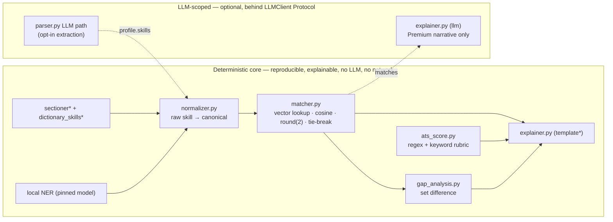
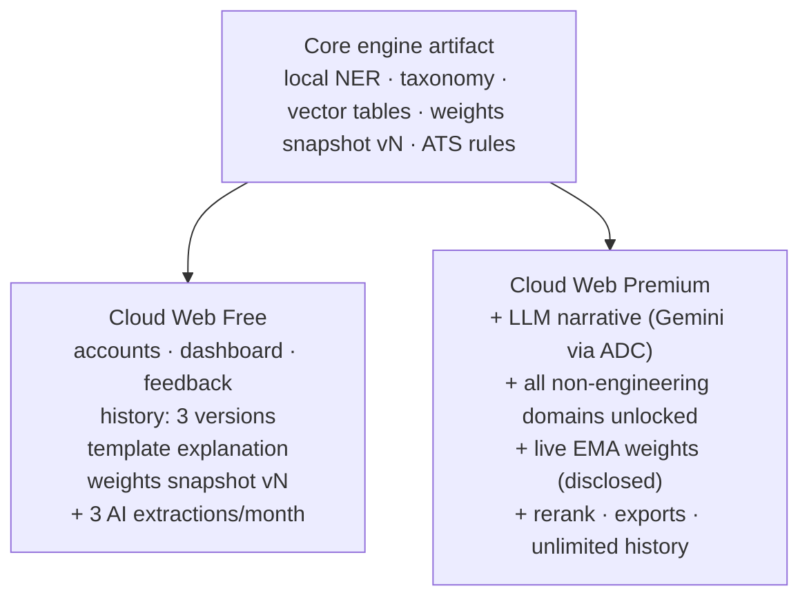
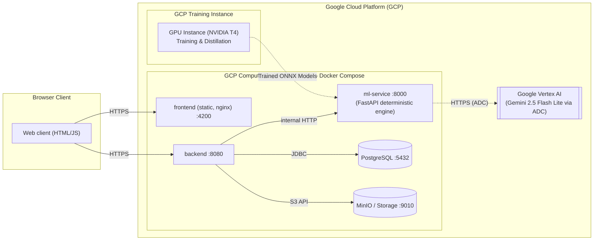

# System architecture

> Project: Intelligent Resume Analyser and Career Recommendation System
> Scope: a candidate-facing resume analyser, delivered as a cloud platform on Google Cloud Platform (GCP) with two tiers, Cloud Web Free and Cloud Web Premium. Both share one deterministic core engine with an explainable score, and call Google Vertex AI for specific tasks. The offline self-hosted distribution is archived in [`docs/archive/community-edition.md`](archive/community-edition.md).

## 1. Why this architecture

Most "AI resume analyser" projects wrap a single chat-style LLM prompt around the whole problem. That makes results unreproducible (the same resume scores differently on two runs, even at temperature 0, as the [research](editions-and-parity.md#6-research-behind-the-design) shows), unexplainable, and dependent on whichever LLM endpoint was reached.

This system is built the opposite way. A deterministic core engine does all extraction, normalization, matching and scoring with plain code and pinned local models: regex, a lookup table, a local NER model, precomputed embedding vectors, cosine similarity and an integer ATS rubric. An LLM handles two narrow tasks: turning already-computed numbers into a coaching narrative (Premium), and extracting non-engineering resumes across the 22 other domains. The LLM never decides a score or a ranking, so results are reproducible across all tiers ([SRS §3.11](srs.md#311-core-engine-architecture-and-result-parity-revised-in-v22)).

## 2. Component diagram

Three deployable services, all implemented, hosted on GCP:

## 3. The deterministic-core / narrow-LLM split

No path that produces a number touches the LLM:

Properties that follow:

- Reproducibility. The same resume text and the same `engine_fingerprint` give the same profile, ATS score, matches and gaps. Cross-CPU floating-point drift (≈ 1e-5) is absorbed by rounding to two decimals before ranking, with a deterministic tie-break ([SRS FR-3.5](srs.md#33-career-recommendation-engine)); the matcher's vectors are shipped constants, so it has no drift at all.
- Graceful degradation (NFR-3.1). An LLM outage cannot affect a score. With the template explainer as default, it cannot affect Web Free at all; only the Premium coaching narrative field is at risk.
- Deterministic score path (NFR-3.2). Nothing on the score path downloads or calls out to third-party generative models.

## 4. Cloud tiers

Web Free and Web Premium share the same deterministic core engine. Premium adds fields and narrative coaching on top of the same base score. The historical offline self-hosted design is archived in [`docs/archive/community-edition.md`](archive/community-edition.md).

## 5. Deployment view (Google Cloud Platform)

The application is deployed to Google Cloud Platform with Docker Compose on an `e2-standard-4` Compute Engine instance (Option A). It is quick to set up and simple to run, and the user's $300 GCP credit pays for it. Model training and distillation jobs run on an on-demand GCP GPU VM (e.g. T4) because the local machine can't handle them.

## 6. Data flow summary

Request lifecycle for `POST /analyze-file` (the backend's one call per upload). Full breakdown in [DFD](dfd.md).

1. Extract: `document_extraction/pdf_extractor.py` produces column-aware text.
2. Segment*: `sectioner.py` splits the text into Skills / Experience / Education / other by heading detection (fallback: whole text).
3. Contact: email/phone regex.
4. Skills: `dictionary_skills.py`* matches taxonomy variants over the whole text; NER "Skills" spans are merged in for recall.
5. NER: `local_ner_parser.py` runs the pinned model on the Experience and Education sections only (today: whole text in 380-word chunks).
6. Normalize: `normalizer.py` maps every skill to its canonical form.
7. Match: `matcher.py` looks up precomputed vectors* (MiniLM only for out-of-taxonomy skills), applies the weights snapshot*, ranks by cosine similarity rounded to 2 dp* with a deterministic tie-break*.
8. ATS: `ats_score.py` runs independently on the raw text.
9. Gaps: `gap_analysis.py` projects `missing_skills`.
10. Explain: `explainer.py` renders the template* (default) or, for Premium requests (`explainer=llm`), calls the LLM. Either way it cannot change a number.
11. Fingerprint*: the response carries `engine_fingerprint`.
12. Persist (web editions): the backend stores `Resume`, `ParsedProfile` (incl. ATS and explanation), `Recommendation` rows; feedback later drives the EMA update and the next weights snapshot.

## Related documents

- [Editions & Parity](editions-and-parity.md): parity mechanism, pipeline restaging, PC spec, costs, research
- [High-Level Design](hld.md) · [Low-Level Design](lld.md) · [DFD](dfd.md) · [Process Flow](process-flow.md)
- [Abstraction Overview](abstraction-overview.md) · [Tech Stack](tech-stack.md) · [SRS v2.0](srs.md)
