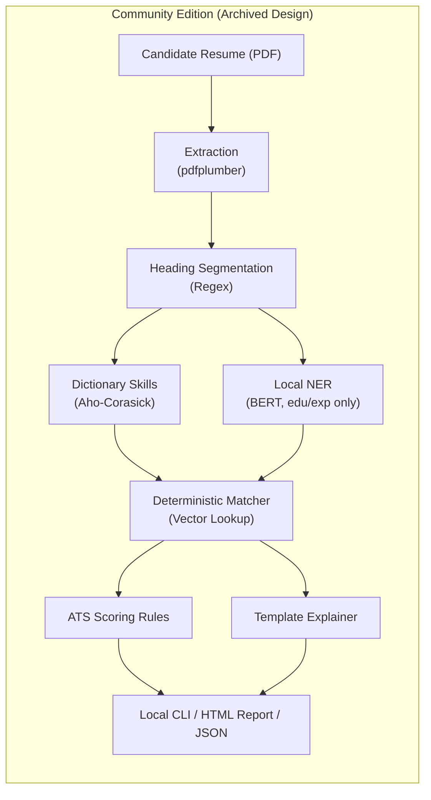

# Archived: Community Edition (offline self-hosted Docker)

> Status: archived / paused (September 2026).  
> Superseded by: Cloud Web Free and Cloud Web Premium, hosted on Google Cloud Platform.  
> Kept for: the Community Edition's technical design, hardware requirements, CLI specification and offline Docker details, in case it is picked up again.

## 1. Overview of the archived edition

The Community Edition was planned as a fully offline, self-hosted distribution of the Career OS for Engineering & Technology resumes. It would run entirely on a user's own PC from a single Docker image or CLI, with no internet access, no cloud credentials and no API costs.

### Main characteristics (archived)
* Delivery: a multi-architecture Docker image (`--network none`) plus a standalone CLI.
* Scope: the Engineering & Technology domain only.
* Engine: the local deterministic pipeline (regex, Aho-Corasick dictionary, pinned local BERT NER model, precomputed embedding lookups).
* Explainer: the deterministic template explainer (no LLM, no external calls).
* Parity: byte-identical results to the hosted Web Free tier for the same engineering resume and engine fingerprint.



## 2. Hardware and environment specifications (PC baseline)

The offline distribution was sized for modest consumer hardware without a GPU:

| Specification | Minimum target | Recommended target |
|---|---|---|
| CPU | 2 cores, x86-64 with AVX2, or Apple Silicon / arm64 | 4 cores |
| RAM | 4 GB (pipeline peak memory ≈ 1 to 1.5 GB) | 8 GB |
| Disk | 3 GB free (Docker image ≈ 1.5 GB with CPU-only PyTorch; ≈ 0.7 GB with ONNX Runtime) | 5 GB |
| GPU | None required | None |
| Network | Required only to pull the Docker image; 0 bytes at runtime | None |

### Model footprints in the archived image
* NER model: `yashpwr/resume-ner-bert` (431 MB fp32; target ~130 MB fp32 / ~35 MB int8 after planned distillation).
* Sentence embeddings: `all-MiniLM-L6-v2` (~90 MB).
* Lookup tables and taxonomy: `skill_vectors.npy`, `role_vectors.npy`, and `skill_taxonomy.json` (< 2 MB).
* Idle unload: a configurable `ENGINE_IDLE_UNLOAD_SECONDS` unloads the PyTorch weights when idle, keeping baseline memory under 300 MB.

## 3. Command-line interface (CLI) specification

The planned Community CLI evaluated single resumes or batches from the terminal:

```bash
# Analyze a resume and output JSON to stdout
docker run --rm --network none -v $(pwd):/data \
  resume-analyser:community \
  analyze /data/resume.pdf

# Target a specific role and generate an HTML report
docker run --rm --network none -v $(pwd):/data \
  resume-analyser:community \
  analyze /data/resume.pdf --role "Machine Learning Engineer" --html -o /data/report.html
```

### CLI arguments
* `analyze <path_to_pdf>`: path to the PDF resume.
* `--role <role_name>`: optional; focus matching and gap analysis on one catalogue role.
* `--json`: output raw structured JSON.
* `--html`: generate a self-contained static HTML report.
* `-o, --output <path>`: write the report to this file.

## 4. Result-parity research precedents

Keeping the offline engine identical to the cloud version was modelled on three open-core and developer-tool products:

1. SonarQube Community vs Cloud: the same analysis engine and ruleset run locally and in the cloud and produce identical findings. Paid cloud editions add enterprise governance and cross-repository analyzers without changing core rule outputs.
2. Semgrep Community vs Pro: single-file semantic analysis gives identical results in OSS and Pro. Pro adds inter-file taint tracking as a separate layer on top.
3. Plane Community vs Commercial: the open-source community edition matches the cloud free tier; commercial tiers add hosted team collaboration and advanced integrations.

## 5. Rationale for archiving

In September 2026, development moved from a self-hosted local container to a cloud-first deployment on Google Cloud Platform (GCP), for these reasons:

1. Local hardware limits: full model training, fine-tuning and local container orchestration demand more CPU and RAM than consumer PCs have.
2. One delivery path paid for by cloud credits: Google Cloud resources and the $300 GCP credit make it possible to
   - host the deterministic core alongside Google Vertex AI (Gemini 2.5 Flash Lite) for the 22 non-engineering domains, and
   - run all heavy model training, fine-tuning and distillation jobs on GCP GPU and Compute instances.
3. Simpler for users: they use the whole platform in a browser, with no Docker to install, no local volumes to configure and no host-architecture problems to debug.

The code, taxonomies and deterministic scoring logic built for the Community Edition are still the core engine of the cloud architecture.
