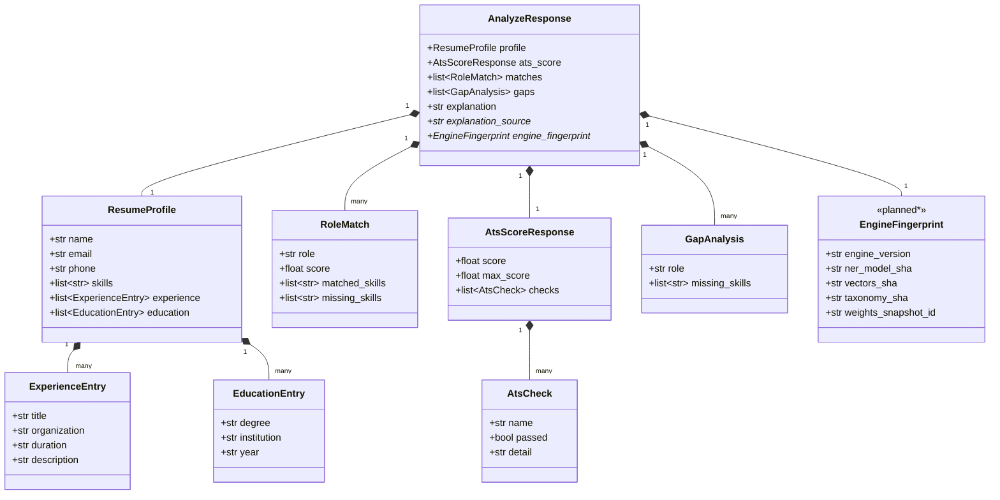

# Class diagram

Two diagrams: the ML-service classes and the backend JPA entity classes. The ML-service diagram covers the Pydantic models and the service functions. Both are implemented; classes marked `*` are planned additions from the [implementation order](editions-and-parity.md#7-implementation-order). [Entities & Fields](entities-and-fields.md) has the full source for every class.

## 1. Implemented: ML service (`ml-service/app/`)

### 1.1 Data classes (Pydantic models, `models/schemas.py`)

The request-only models (`ParseRequest`, `MatchRequest`, `AtsScoreRequest`, `AnalyzeRequest`) are left out to keep the diagram readable; [Entities & Fields](entities-and-fields.md) lists their fields.

### 1.2 Service classes (behavioral view of `services/*.py`)

In Python these are modules of functions. Python modules of free functions don't map one-to-one to UML classes, so each module is drawn as a class with static-style operations, the usual way to diagram a functional module.

```mermaid
classDiagram
    class LLMClient {
        <<Protocol>>
        +complete(system_prompt, user_prompt) str
    }
    class GroqLLMClient {
        -Groq _client
        -str _model
        +complete(system_prompt, user_prompt) str
    }
    class GeminiLLMClient {
        -Client _client
        -str _model
        +complete(system_prompt, user_prompt) str
    }
    class DocumentTextExtractor {
        <<Protocol>>
        +extract(file_bytes) str
    }
    class PdfTextExtractor {
        <<pdf_extractor.py>>
        +extract(file_bytes) str
    }
    class Sectioner {
        <<sectioner.py*>>
        +split(resume_text) Sections
    }
    class DictionarySkillExtractor {
        <<dictionary_skills.py*>>
        +find_skills(resume_text) list~str~
    }
    class Explainer {
        <<Protocol*>>
        +explain(profile, ats_score, matches, gaps) str
    }
    class TemplateExplainer {
        <<explainer.py*>>
        +explain(...) str
    }
    class LLMExplainer {
        <<explainer.py>>
        -LLMClient client
        +explain(...) str
    }
    class VectorTable {
        <<matcher.py*>>
        -ndarray skill_vectors
        -ndarray role_vectors
        -dict weights
        +lookup(skill) ndarray
    }
    class ResumeParser {
        <<parser.py>>
        +parse_resume(resume_text, client) ResumeProfile
    }
    class LocalNerResumeParser {
        <<local_ner_parser.py>>
        +parse_resume_local(resume_text, ner_pipeline) ResumeProfile
    }
    class SkillNormalizer {
        <<normalizer.py>>
        +normalize_skill(raw_skill) str
        +normalize_skills(raw_skills) list~str~
    }
    class EmbeddingService {
        <<embeddings.py>>
        +embed(texts) ndarray
        +cosine_similarity(a, b) float
    }
    class RoleMatcher {
        <<matcher.py>>
        +match_roles(raw_skills, top_n) list~RoleMatch~
    }
    class AtsScorer {
        <<ats_score.py>>
        +score_resume(resume_text, target_keywords) AtsScoreResponse
    }
    class GapAnalyzer {
        <<gap_analysis.py>>
        +analyze_gaps(matches) list~GapAnalysis~
    }

    GroqLLMClient ..|> LLMClient
    GeminiLLMClient ..|> LLMClient
    PdfTextExtractor ..|> DocumentTextExtractor
    ResumeParser --> LocalNerResumeParser : uses (default)
    ResumeParser --> LLMClient : uses (opt-in, PARSER_BACKEND=llm)
    TemplateExplainer ..|> Explainer
    LLMExplainer ..|> Explainer
    LLMExplainer --> LLMClient : uses
    Sectioner --> ResumeParser : sections → NER
    Sectioner --> DictionarySkillExtractor : text
    DictionarySkillExtractor --> SkillNormalizer : uses
    RoleMatcher --> SkillNormalizer : uses
    RoleMatcher --> VectorTable : uses (planned)
    RoleMatcher --> EmbeddingService : fallback for unknown skills
    ResumeParser --> ResumeProfile : returns
    LocalNerResumeParser --> ResumeProfile : returns
    RoleMatcher --> RoleMatch : returns
    AtsScorer --> AtsScoreResponse : returns
    GapAnalyzer --> GapAnalysis : returns
```

## 2. Implemented: backend JPA entities (`backend/src/main/java/com/resumeanalyser/`)

Object-oriented view of [Entity Diagram](entity-diagram.md) / [Database Schema](database-schema.md), matching the Flyway `V1` schema field-for-field.

```mermaid
classDiagram
    class UserRole {
        <<enumeration>>
        USER
        PREMIUM_USER
        ADMIN
    }
    class User {
        -UUID id
        -String email
        -String passwordHash
        -UserRole role
        -Instant createdAt
    }
    class Resume {
        -UUID id
        -User user
        -String fileRef
        -int version
        -Instant uploadedAt
        +ParsedProfile parsedProfile
    }
    class ParsedProfile {
        -UUID id
        -Resume resume
        -String name
        -String email
        -String phone
        -List~String~ skills
        -List~ExperienceEntry~ experience
        -List~EducationEntry~ education
        -double atsScore
        -double atsMaxScore
        -List~AtsCheckEntry~ atsChecks
        -String explanation
    }
    class Role {
        -UUID id
        -String title
        -String description
        +List~SkillVector~ skillVectors
    }
    class SkillVector {
        -UUID id
        -Role role
        -String skill
        -double weight
        -Instant versionTimestamp
        -boolean current
    }
    class Recommendation {
        -UUID id
        -User user
        -Role role
        -Resume resume
        -double matchScore
        -List~String~ matchedSkills
        -List~String~ missingSkills
        -Instant createdAt
    }
    class Feedback {
        -UUID id
        -Recommendation recommendation
        -SkillVector skillVectorVersion
        -boolean helpful
        -Instant createdAt
    }

    User --> UserRole : role
    User "1" --> "many" Resume : owns
    Resume "1" --> "many" Recommendation : run produced
    Resume "1" --> "0..1" ParsedProfile : produces
    User "1" --> "many" Recommendation : receives
    Role "1" --> "many" Recommendation : "recommended as"
    Role "1" --> "many" SkillVector : "versioned weights"
    Recommendation "1" --> "many" Feedback : collects
    SkillVector "1" --> "many" Feedback : "active for"
```

## Related documents

- [Entity Diagram](entity-diagram.md)
- [Entities & Fields](entities-and-fields.md): full source code for every class above
- [LLD](lld.md)
