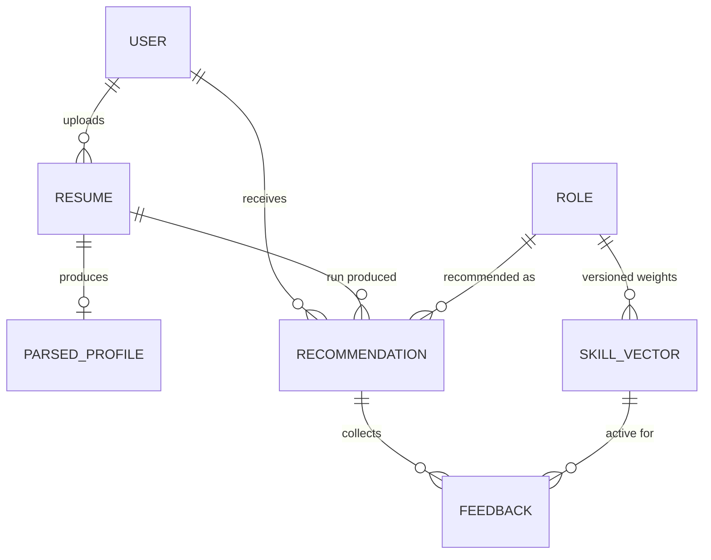

# Database schema

Physical design of the PostgreSQL 15 store. The source of truth is the Flyway migration `backend/src/main/resources/db/migration/V1__init_schema.sql`, which matches the JPA entities field for field (`spring.jpa.hibernate.ddl-auto: validate` stops startup if they drift apart). Below is that DDL with commentary. The conceptual view is in [Entity Diagram](entity-diagram.md).

## 1. ER diagram



## 2. DDL (as applied by `V1__init_schema.sql`)

```sql
CREATE EXTENSION IF NOT EXISTS pgcrypto;

-- Users & authentication (NFR-2.1, NFR-2.2) + RBAC (FR-12.1)
CREATE TABLE users (
    id              UUID PRIMARY KEY DEFAULT gen_random_uuid(),
    email           VARCHAR(320) NOT NULL UNIQUE,
    password_hash   VARCHAR(255) NOT NULL,                  -- bcrypt
    role            VARCHAR(20) NOT NULL DEFAULT 'USER',    -- USER | PREMIUM_USER | ADMIN
    created_at      TIMESTAMPTZ NOT NULL DEFAULT now()
);

-- Resumes: one row per uploaded VERSION, never overwritten (FR-1.5)
CREATE TABLE resumes (
    id              UUID PRIMARY KEY DEFAULT gen_random_uuid(),
    user_id         UUID NOT NULL REFERENCES users(id) ON DELETE CASCADE,
    file_ref        TEXT NOT NULL,                          -- MinIO object key, never the bytes
    version         INTEGER NOT NULL,
    uploaded_at     TIMESTAMPTZ NOT NULL DEFAULT now(),
    UNIQUE (user_id, version)
);
CREATE INDEX idx_resumes_user_id ON resumes (user_id);

-- Parsed profiles: extraction output + the ATS/explanation from the same
-- /analyze-file call, so the dashboard never re-calls the ML service.
CREATE TABLE parsed_profiles (
    id              UUID PRIMARY KEY DEFAULT gen_random_uuid(),
    resume_id       UUID NOT NULL UNIQUE REFERENCES resumes(id) ON DELETE CASCADE,
    name            VARCHAR(255) NOT NULL DEFAULT '',
    email           VARCHAR(320) NOT NULL DEFAULT '',
    phone           VARCHAR(50)  NOT NULL DEFAULT '',
    skills          JSONB NOT NULL DEFAULT '[]',
    experience      JSONB NOT NULL DEFAULT '[]',
    education       JSONB NOT NULL DEFAULT '[]',
    ats_score       DOUBLE PRECISION NOT NULL DEFAULT 0,
    ats_max_score   DOUBLE PRECISION NOT NULL DEFAULT 0,
    ats_checks      JSONB NOT NULL DEFAULT '[]',
    explanation     TEXT NOT NULL DEFAULT ''
);

-- Curated job roles (title/description); skills come from skill_vectors
CREATE TABLE roles (
    id              UUID PRIMARY KEY DEFAULT gen_random_uuid(),
    title           VARCHAR(255) NOT NULL UNIQUE,
    description     TEXT NOT NULL DEFAULT ''
);

-- Versioned, EMA-updated skill-vector store (FR-7.1–7.4).
-- Every update INSERTs a new version; prior versions are retained.
CREATE TABLE skill_vectors (
    id                  UUID PRIMARY KEY DEFAULT gen_random_uuid(),
    role_id             UUID NOT NULL REFERENCES roles(id) ON DELETE CASCADE,
    skill               VARCHAR(255) NOT NULL,
    weight              DOUBLE PRECISION NOT NULL,
    version_timestamp   TIMESTAMPTZ NOT NULL DEFAULT now(),
    current             BOOLEAN NOT NULL DEFAULT true,
    UNIQUE (role_id, skill, version_timestamp)
);
CREATE INDEX idx_skill_vectors_current ON skill_vectors (role_id, skill) WHERE current;

-- Recommendations: one row per (user, role) per analysis run, tied to the resume version
CREATE TABLE recommendations (
    id              UUID PRIMARY KEY DEFAULT gen_random_uuid(),
    user_id         UUID NOT NULL REFERENCES users(id) ON DELETE CASCADE,
    role_id         UUID NOT NULL REFERENCES roles(id) ON DELETE CASCADE,
    resume_id       UUID NOT NULL REFERENCES resumes(id) ON DELETE CASCADE,
    match_score     DOUBLE PRECISION NOT NULL,
    matched_skills  JSONB NOT NULL DEFAULT '[]',
    missing_skills  JSONB NOT NULL DEFAULT '[]',
    created_at      TIMESTAMPTZ NOT NULL DEFAULT now()
);
CREATE INDEX idx_recommendations_user_id ON recommendations (user_id, created_at DESC);
CREATE INDEX idx_recommendations_resume_id ON recommendations (resume_id);

-- Feedback: the signal that feeds the EMA update (FR-7.3, FR-10.1, FR-10.2)
CREATE TABLE feedback (
    id                          UUID PRIMARY KEY DEFAULT gen_random_uuid(),
    recommendation_id           UUID NOT NULL REFERENCES recommendations(id) ON DELETE CASCADE,
    skill_vector_version_id     UUID REFERENCES skill_vectors(id) ON DELETE SET NULL,
    helpful                     BOOLEAN NOT NULL,
    created_at                  TIMESTAMPTZ NOT NULL DEFAULT now()
);
CREATE INDEX idx_feedback_recommendation_id ON feedback (recommendation_id);
```

## 2b. Later migrations

| Migration | Adds |
|---|---|
| `V2__add_explanation_source.sql` | `parsed_profiles.explanation_source VARCHAR(20)`: `'template'` or `'llm'` (FR-5.4). |
| `V3__domains_and_locks.sql` | `parsed_profiles.domain`, `domain_name`, `domain_confidence`, `domain_engine` (`local`/`llm`), `domain_tier` (`free`/`premium`), `recommendations_locked BOOLEAN`, `lock_reason`: what `domain_classifier.py` detected and whether a Premium-only domain was analysed at the free tier (FR-12.6). `roles.domain VARCHAR(64)` (+ index): which domain's catalogue a role comes from. Existing rows default to `engineering` / `local` / `free` / unlocked. |

A re-analysis (`POST /resumes/{id}/reanalyze`, FR-12.7) updates the resume's `parsed_profiles` row in place and deletes-then-recreates its `recommendations` rows; `feedback` rows on the deleted recommendations go with them through `ON DELETE CASCADE`.

## 3. The EMA update, as implemented

`SkillVectorService` (backend) applies `new_weight = α × new_signal + (1 − α) × old_weight` with `α = app.skill-vector.alpha` (default 0.3), where `new_signal` is the helpful ratio per skill computed by `FeedbackService` once a role has at least `app.skill-vector.feedback-threshold` (default 5) votes. One cycle, in SQL terms:

```sql
SELECT weight FROM skill_vectors WHERE role_id = :role_id AND skill = :skill AND current LIMIT 1;

BEGIN;
UPDATE skill_vectors SET current = false WHERE role_id = :role_id AND skill = :skill AND current;
INSERT INTO skill_vectors (role_id, skill, weight, version_timestamp, current)
VALUES (:role_id, :skill, :new_weight, now(), true);
COMMIT;
```

History stays queryable (`ORDER BY version_timestamp`) for FR-7.4, and the partial index keeps the hot-path lookup fast. Missing (role, skill) pairs start at `DEFAULT_WEIGHT = 1.0`.

## 4. Planned additions

| Change | Step | Detail |
|---|---|---|
| `parsed_profiles.engine_fingerprint JSONB` | 1 | Records which engine release produced each stored score, so history views and support can explain differences between versions. Migration `V4`. |
| Weights snapshot export | 3 | Not a table. `GET /roles/skill-vectors/snapshot` (`ADMIN`) serialises all `current` rows as `{snapshot_id, created_at, sha256, weights{role→skill→weight}}`; the file ships inside the next core-engine release and its id appears in the fingerprint. |
| Admin-editable taxonomy / roles | later | `skills` and `role_skills` tables replacing the JSON files (FR-2.3), hashed into the fingerprint on export. |
| Consent flag for training data | 7 | `users.training_consent BOOLEAN NOT NULL DEFAULT false` (FR-13.4). Migration `V4`. |

## 5. Mapping to the ML service

The ML service does not read PostgreSQL. Roles and skills reach it as files: `role_skills.json` / `skill_taxonomy.json` today, plus `weights_snapshot.json` after step 3 (so the weighted mean in `matcher.py` uses the same numbers on the web and in Community). The file boundary is deliberate. It lets the Community image run with no database and no network and still use the weights learned on the web.

## Related documents

- [Entity Diagram](entity-diagram.md) · [Entities & Fields](entities-and-fields.md) · [LLD](lld.md) · [Process Flow §4](process-flow.md#4-flow-feedback-ema-skill-vector-update-weights-snapshot-implemented-snapshot-planned)
