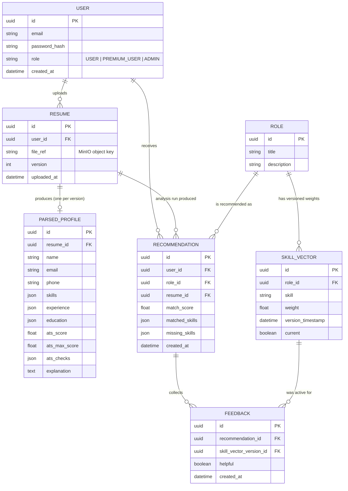

# Entity diagram (conceptual / logical)

Source: [SRS v2.0 §7](srs.md#7-data-requirements), the JPA entities under `backend/src/main/java/com/resumeanalyser/`, and the Flyway migration `V1__init_schema.sql`. This is the conceptual model; see [Database Schema](database-schema.md) for the physical design.

## Diagram

Two parts of the data model are not tables. The weights snapshot is a hashed JSON export of the current `SKILL_VECTOR` rows, shipped inside each core-engine release (FR-7.5). The engine fingerprint is a response field holding the engine version and the hashes of the NER model, vector tables, taxonomy and snapshot (FR-11.2). A planned column will store the fingerprint alongside `PARSED_PROFILE`, so history views can show which engine produced each score.

## Relationship notes

| Relationship | Cardinality | Why |
|---|---|---|
| User → Resume | 1 : N | FR-1.5: every upload is a new, timestamped version. |
| Resume → ParsedProfile | 1 : 0..1 | One structured profile (plus ATS breakdown and explanation) per resume version. |
| User → Recommendation | 1 : N | One row per matched role per analysis run (FR-3.4). |
| Resume → Recommendation | 1 : N | Links each recommendation to the analysis run that produced it, so the dashboard reads "this version's recommendations" directly. |
| Role → Recommendation | 1 : N | A role is recommended to many users over time. |
| Role → SkillVector | 1 : N | Versioned weight store: one row per (role, skill, version_timestamp), with exactly one `current` per (role, skill). |
| Recommendation → Feedback | 1 : N | Allows corrections; the usual case is one feedback per recommendation. |
| SkillVector → Feedback | 1 : N | FR-10.2: feedback records the weight version active when it was given, which makes the EMA update auditable. |

## What's implemented vs. modeled-only

The whole schema above is implemented (Flyway `V1__init_schema.sql`, `ddl-auto: validate`). Still modeled only: storing the engine fingerprint per profile (step 1), the weights snapshot export (step 3), and moving `roles`/taxonomy content from JSON files into admin-editable tables (FR-2.3, later).

`ParsedProfile.skills` / `experience` / `education` / `ats_checks` are `jsonb`, mirroring the ML service's Pydantic shapes; normalizing them into child tables is a post-MVP refinement.

## Related documents

- [Database Schema](database-schema.md) · [Class Diagram](class-diagram.md) · [Entities & Fields](entities-and-fields.md)
