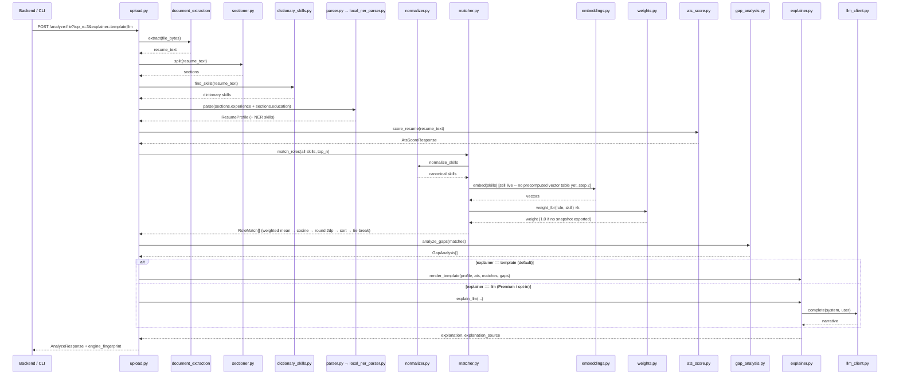

# Low-level design (LLD)

Module-level design for the ML service / core engine (`ml-service/`) and the backend (`backend/`). Steps 1 to 3 of the [implementation order](editions-and-parity.md#7-implementation-order) (core engine self-containment, the restaged pipeline and the weights snapshot) are implemented in code, as is part of step 5 (tier-gated explainer and history limit). Anything tagged *(planned, step N)* either needs a real run that hasn't been done yet (ONNX model export and content-hash pinning, GCP deployment, generating golden-suite fixtures, training a model) or isn't built. The standalone offline Community Docker image is archived in [`docs/archive/community-edition.md`](archive/community-edition.md).

## 1. Module map

```
ml-service/app/
├── main.py                 # FastAPI app; analyze_router + upload_router; GET /health + engine_fingerprint
├── config.py               # Settings (.env); explainer_backend, engine_version, model revisions
├── models/schemas.py       # Pydantic contracts incl. EngineFingerprint, AnalyzeRequest.explainer
├── routers/
│   ├── analyze.py          # POST /parse /match /ats-score /analyze
│   └── upload.py           # POST /parse-file /analyze-file (+ explainer query param)
├── services/
│   ├── document_extraction/  # DocumentTextExtractor Protocol, PdfTextExtractor, registry
│   ├── sectioner.py        # headings → {skills, experience, education, other}
│   ├── dictionary_skills.py# whole-text taxonomy phrase matching (token-based, see file docstring)
│   ├── parser.py           # text → ResumeProfile; local NER (default) | LLM (opt-in)
│   ├── local_ner_parser.py # NER scoped to Experience/Education, merged with dictionary skills
│   ├── normalizer.py       # raw skill → canonical
│   ├── embeddings.py       # sentence-transformers wrapper (still the hot path -- no precomputed vector table yet)
│   ├── weights.py          # loads weights_snapshot.json if present; DEFAULT_WEIGHT=1.0 otherwise
│   ├── matcher.py          # weighted mean (weights.py) + cosine, round(2)+tie-break by role name
│   ├── ats_score.py        # rule-based rubric
│   ├── gap_analysis.py     # missing-skill projection
│   ├── fingerprint.py      # engine_fingerprint: taxonomy content hash + configured model identifiers
│   ├── explainer.py        # TemplateExplainer (default) | LLMExplainer, falls back to template on LLM failure
│   └── llm_client.py       # LLMClient Protocol + Groq/Gemini implementations
└── data/
    ├── skill_taxonomy.json # canonical → [variants]
    ├── role_skills.json    # [{role, skills[]}]
    ├── skill_vectors.npy   # (planned, step 2) taxonomy × 384 -- not yet generated, needs a real model run
    ├── role_vectors.npy    # (planned, step 2)
    ├── vectors.sha256      # (planned, step 2)
    └── weights_snapshot.json # optional; exported by GET /roles/skill-vectors/snapshot, absent by default
ml-service/scripts/          # (planned) precompute_vectors.py, bench.py, download_models.py
ml-service/training/         # (planned, step 7) cloud training on GCP (train_ner.py, train_embed.py, config.py)
ml-service/tests/golden/     # (planned, step 6) fixtures + expected outputs per engine version
```

Still planned: real ONNX content-hash pinning of the NER/embedding model weights (in place of hashing their configured identifier), the precomputed vector tables, the Community Docker image, golden-suite fixtures and the training pipeline. Each needs a model run, download or dataset that hasn't been done yet (see [Editions & Parity §7](editions-and-parity.md#7-implementation-order)).

## 2. API contracts

All ML endpoints are mounted without a prefix. `engine_fingerprint` and `explanation_source` are implemented; existing clients ignore unknown fields (the backend explicitly wires its RestClient's ObjectMapper for this, see `MlServiceClientConfig`).

### `POST /parse` · `POST /parse-file`
Text (or multipart `file`, PDF only; `415` otherwise) → `ParseResponse { profile: ResumeProfile }`. Local NER by default; `PARSER_BACKEND=llm` opt-in. On the local path `experience[*].description` is always `""`.

### `POST /match`
```jsonc
// MatchRequest
{ "skills": ["string"], "top_n": 5 }
// MatchResponse
{ "matches": [ { "role": "string", "score": 0.0, "matched_skills": [], "missing_skills": [] } ],
  "engine_fingerprint": { /* see below */ } }
```
`score` is cosine similarity rounded to 2 dp before sorting, with ties broken by role name, truncated to `top_n`.

### `POST /ats-score`
`{ resume_text, target_keywords[] }` → `{ score, max_score, checks[] }`. `max_score` is `90.0`, or `110.0` when keywords are supplied.

### `POST /analyze` · `POST /analyze-file`
```jsonc
// AnalyzeRequest (JSON) / query params on /analyze-file
{ "resume_text": "string", "top_n": 3, "explainer": "template" }   // explainer: "template" (default) | "llm"

// AnalyzeResponse
{
  "profile": { /* ResumeProfile */ },
  "ats_score": { /* AtsScoreResponse */ },
  "matches": [ /* RoleMatch[] */ ],
  "gaps": [ { "role": "string", "missing_skills": [] } ],
  "explanation": "string",
  "explanation_source": "template",              // "template" | "llm" -- "llm" falls back to "template" on LLM failure (NFR-3.1)
  "engine_fingerprint": {
    "engine_version": "0.1.0",
    "ner_model_sha": "…", "embed_model_sha": "…",
    "taxonomy_sha": "…", "weights_snapshot_id": "uniform"
  }
}
```
`ner_model_sha`/`embed_model_sha` hash the configured model identifier (name + pinned revision), not the downloaded weights themselves; see `fingerprint.py`'s docstring for why, and [Editions & Parity §7](editions-and-parity.md#7-implementation-order) step 1 for the real ONNX content-hash pinning this stands in for. `weights_snapshot_id` is `"uniform"` until an admin exports a snapshot via `GET /roles/skill-vectors/snapshot`.

### `GET /health`
`{ "status": "ok", "engine_fingerprint": { … } }`: the liveness probe, and the value a Community user compares against the web deployment (FR-11.2).

## 3. Sequence diagram: `POST /analyze-file`



The vector-table lookup (step 2 of [Editions & Parity §7](editions-and-parity.md#7-implementation-order)) is not yet built: `embeddings.embed()` still runs live on every `/analyze-file` call, because precomputing `skill_vectors.npy`/`role_vectors.npy` needs one run of the embedding model against the full taxonomy, which hasn't been done yet.

## 4. Matching algorithm

`matcher.match_roles(raw_skills, top_n)`:

1. `normalize_skills(raw_skills)`: dedupe and canonicalize, preserving order.
2. Candidate vector = mean of each canonical skill's vector via `embeddings.embed(...)`, called live per request. *(planned, step 2)* `skill_vectors.npy[index[skill]]`, with `embed()` only for skills not in the table.
3. For each role: role vector = weighted mean of its skills' embeddings (`weights.weight_for(role, skill)`, default 1.0 when no snapshot has been exported, matching the backend's `SkillVectorService.DEFAULT_WEIGHT`), `lru_cache`d per role name. *(planned, step 2)* backed by `role_vectors.npy` instead of live embedding.
4. `score = round(cosine(candidate, role), 2)`; `matched` / `missing` are exact set operations.
5. Sort by `(-score, role_name)`; return `top_n`.

Complexity: O(k) embedding calls (still live, not table lookups until step 2) + O(R) cosine products, R = number of roles. Determinism: the 2-dp rounding before sorting absorbs cross-CPU floating-point drift (≈ 1e-5) in the cosine product; full reproducibility across architectures still depends on step 2's shipped-constant vector tables (`embeddings.embed()`'s own output isn't guaranteed bit-identical across hardware today).

## 5. ATS scoring rubric

`ats_score.score_resume(resume_text, target_keywords, hidden_word_count)` runs independent, additive checks:

| Check | Weight | Method |
|---|---|---|
| `contact_email` | 15.0 | Regex |
| `contact_phone` | 10.0 | Regex |
| `section_experience` | 15.0 | "experience" / "work experience" / "employment history" |
| `section_education` | 15.0 | "education" / "academic background" |
| `section_skills` | 15.0 | "skills" / "technical skills" / "core competencies" |
| `sufficient_length` | 10.0 | ≥ 150 words |
| `no_hidden_text` | 10.0 | Fails when the file extractor left out hidden words (white, under 3 pt or off-page text in a PDF; `document_extraction.ExtractedText.hidden_word_count`). Text sent as JSON has no file and passes |
| `keyword_coverage` (optional) | 20.0 | Only when `target_keywords` non-empty; proportional credit; `passed` at ≥ 0.5 |

Base `max_score` 90.0; +20.0 with keywords. Integer arithmetic; bit-identical everywhere.

## 6. Error handling and degradation

- LLM failure on the opt-in extraction path (`PARSER_BACKEND=llm`) propagates as 500 today; hardening to a typed 502/503 is a follow-up. It does not exist on the default local path.
- `/match`, `/ats-score`, `/parse`, `/parse-file` never touch the LLM. With `explainer=template` (the default) neither does `/analyze`/`/analyze-file`; with `explainer=llm`, a failed LLM call falls back to the deterministic template rather than failing the request (`explanation` is the template's text and `explanation_source="template"`; NFR-3.1).
- Models load once per process (`lru_cache`). *(planned)* `ENGINE_IDLE_UNLOAD_SECONDS` releases the NER model after idle time in Community mode.
- Known local-path limits: `description` always empty; proximity heuristics for durations; mitigated by column-aware extraction and section-scoped NER (Experience/Education only, via `sectioner.py`).

## 7. Backend module design: implemented

Domain packages under `com.resumeanalyser.*`; each owns its entity, DTOs, controller, service, repository and exceptions. Cross-cutting concerns live in `common` (`GlobalExceptionHandler`, `ApiError`, `LoggingAspect`, `OpenApiConfig`).

| Package | Responsibility | Endpoints |
|---|---|---|
| `account` | `User`, `UserRole` (`USER` / `PREMIUM_USER` / `ADMIN`), `UserRepository` | none |
| `auth` | JWT issue/validate, `SecurityConfig` (stateless, `@EnableMethodSecurity`, CORS), `UserDetailsServiceImpl` (role re-read per request) | `POST /auth/register`, `POST /auth/login` |
| `resume` | Upload (PDF ≤ 5 MB), versioning (USER capped at the 3 most recent, FR-6.2/12.2), MinIO storage (`ResumeStorageService`, key `userId/version-filename`), one ML call per upload with a tier-selected `explainer`, `ParsedProfile` persistence incl. ATS + explanation + `explanationSource` | `POST /resumes`, `GET /resumes`, `GET /resumes/{id}/profile` |
| `recommendation` | `Role`, `Recommendation` (with `resume`, `matchedSkills`, `missingSkills`), dashboard read incl. `explanationSource` | `GET /recommendations/dashboard` |
| `feedback` | `Feedback` linked to recommendation + active `SkillVector` version; triggers recompute past the threshold | `POST /feedback`, `GET /feedback/{recommendationId}` |
| `skillvector` | Versioned `SkillVector`; EMA `new = α·signal + (1−α)·old` (`SkillVectorService`), `recomputeAll`; role-spanning, hashed weights export (`SkillVectorSnapshotService`, FR-7.5) | `GET /roles/{roleId}/skill-vectors`, `POST /roles/{roleId}/skill-vectors/recompute` (`ADMIN`), `GET /roles/skill-vectors/snapshot` (`ADMIN`) |
| `client` | `MlServiceClient` (`RestClient`, `app.ml-service.base-url`), wraps `POST /analyze-file`; maps 415 and connectivity errors to typed exceptions | none |

### 7.1 Package convention
Domain modules, not technical layers; layers inside a module are added when it gets its first endpoint; services are concrete classes; module-scoped `@RestControllerAdvice`; AOP for logging (it never logs arguments, because DTOs carry passwords and JWTs).

### 7.2 `auth` and RBAC
HS256 JWT signed with `app.jwt.secret`, expiry `app.jwt.expiration-ms` (default 24 h). `SecurityConfig` decides only whether a request is authenticated; per-endpoint roles are declared on controller methods with `@PreAuthorize`. Role is read fresh from the DB on every request, so an upgrade to `PREMIUM_USER` takes effect immediately.

### 7.3 Decisions that refined the original plan
- One ML call per upload (`/analyze-file`), not one per module.
- `ParsedProfile` carries `atsScore`, `atsMaxScore`, `atsChecks`, `explanation`; `Recommendation` carries `resume` plus `matchedSkills` / `missingSkills`, so the dashboard never re-calls the ML service.
- Resume files live in MinIO; PostgreSQL keeps only the key.
- The EMA update job is implemented (`SkillVectorService`, tunables `app.skill-vector.alpha=0.3`, `app.skill-vector.feedback-threshold=5`; signal = helpful ratio per skill from `FeedbackService`). The root README's "not yet implemented" note predates commit `9f8b7a0`.
- Tier gating is implemented directly on `ResumeService` (`explainerFor(user)`, `FREE_HISTORY_LIMIT`), not behind a separate `FeatureFlags` abstraction. The only two gated behaviors today (which explainer to request, how much history to return) are each a one-line `UserRole` check with a single caller, so a lookup table would be premature. Add `FeatureFlags` when a third gated behavior needs the same mapping in more than one place.
- There is no frontend Premium page guard yet. An earlier revision of this page sketched one, but the app has no Premium-only page to guard: there is no JD-match page or export flow. What exists is a Premium/Standard badge on the dashboard's coaching-notes card (`isLlmExplanation` in `frontend/src/js/pages/dashboard-rules.js`, driven by `explanationSource`), the one Premium-vs-Free distinction a candidate can see today. Add the guard once a route needs gating.

### 7.4 Weights snapshot export (FR-7.5)
`GET /roles/skill-vectors/snapshot` (`ADMIN`) is served by `SkillVectorSnapshotController` / `SkillVectorSnapshotService`, kept separate from `SkillVectorController` since it isn't scoped to one role. It walks every currently-active `SkillVector` row (`SkillVectorRepository.findByCurrentTrue()`), groups them `role.title → skill → weight` in a `TreeMap` (deterministic key order, so the hash below is stable), and returns `{snapshotId, createdAt, sha256, weights}`, where `sha256` is a SHA-256 of the weights payload. Nothing currently writes this export to `ml-service/app/data/weights_snapshot.json`; until an operator does that by hand (or a follow-up automates it), the engine keeps reading `weights.snapshot_id() == "uniform"`.

### 7.5 Still open (steps 4, 6, 7: these need a real run, not just code)
| Item | Why it's still open |
|---|---|
| Community Dockerfile, compose, CLI | Needs an actual multi-arch image build and a `--network none` run to verify (step 4) |
| Real ONNX content-hash pinning | Needs downloading and exporting the actual NER/embedding models (step 1's remaining piece) |
| Precomputed `skill_vectors.npy` / `role_vectors.npy` | Needs one real run of the embedding model against the full taxonomy (step 2's remaining piece) |
| Golden parity suite in CI | Needs real resume fixtures and a first run to generate their expected outputs (step 6) |
| Training pipeline (`ml-service/training/`), `scripts/bench.py` | Needs real datasets, a training run, and a benchmark run against real hardware (step 7) |

See `backend/README.md` for run instructions.

## Related documents

- [High-Level Design](hld.md) · [Editions & Parity](editions-and-parity.md)
- [Class Diagram](class-diagram.md) · [Entities & Fields](entities-and-fields.md) · [Database Schema](database-schema.md)
