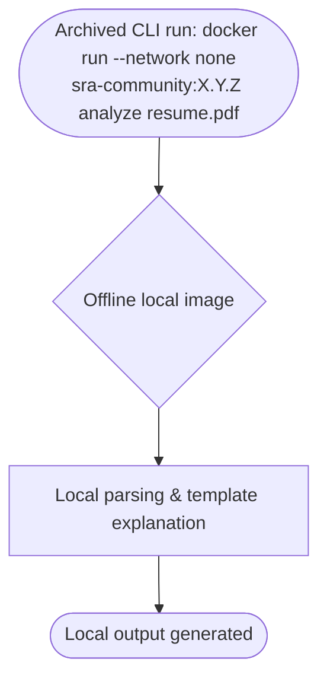
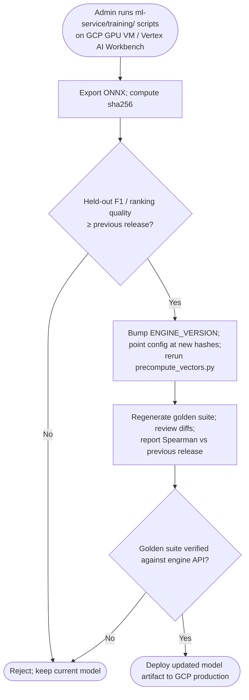

# Process flow

Activity diagrams of the system's end-to-end flows as the user experiences them, with decision points and failure paths. [DFD](dfd.md) shows what data moves where, and [LLD](lld.md) shows the module call sequences.

## 1. Core flow: "Analyze my resume" (implemented; `*` marks a planned step)

```mermaid
flowchart TD
    Start([Candidate uploads a PDF\non Cloud Web Free / Web Premium]) --> Val{Valid input?}
    Val -- No --> ErrIn[Return 422/415 — validation\nor unsupported file type]
    Val -- Yes --> ExtractText[Extract text, column-aware\n(document_extraction/)]
    ExtractText --> Segment["Segment by headings*\nSkills / Experience / Education / other"]
    Segment --> Dict["Dictionary skill match*\n(Aho-Corasick over taxonomy)"]
    Segment --> Parse[NER on Experience + Education*\n(today: whole text)]
    Parse --> ParseOK{Parse succeeded?}
    ParseOK -- No --> ErrParse["Propagate error\n(hardening follow-up)"]
    ParseOK -- Yes --> Norm[Normalize all skills\nagainst canonical taxonomy]
    Dict --> Norm
    Norm --> ATS[Score ATS compatibility\n— rules only]
    Norm --> Lookup["Look up precomputed vectors*\n(MiniLM only for unknown skills)"]
    Lookup --> Match["Rank roles: weighted mean*,\ncosine, round 2dp*, tie-break*"]
    Match --> Gap[Derive skill gaps from\nmissing_skills per role]
    ATS --> Explain
    Match --> Explain
    Gap --> Explain{explainer?}
    Explain -- "template* (default)" --> Tmpl[Render deterministic\nexplanation]
    Explain -- "llm (Premium / opt-in)" --> LLMCall[Call LLM: numbers → prose]
    LLMCall --> ExplainOK{LLM available?}
    ExplainOK -- No --> Degrade["Fall back to template\n(NFR-3.1)"]
    ExplainOK -- Yes --> Assemble
    Tmpl --> Assemble
    Degrade --> Assemble[Assemble AnalyzeResponse\n+ engine_fingerprint*]
    Assemble --> Return([Return to caller])
```

## 2. Flow: resume upload → dashboard (implemented, backend + frontend)

```mermaid
flowchart TD
    U([Candidate uploads PDF]) --> V{PDF and ≤ 5 MB?}
    V -- No --> E1[Reject with clear error — FR-1.3]
    V -- Yes --> S[Store file in MinIO;\ncreate Resume version N+1 — FR-1.5]
    S --> Flags["Resolve tier flags*\n(explainer, history limit)"]
    Flags --> Call[Call ML Service POST /analyze-file\n(one call per upload)]
    Call --> Persist[Persist ParsedProfile (incl. ATS,\nexplanation) and Recommendation rows]
    Persist --> Dash[Render dashboard — profile,\nmatches, gaps, ATS score]
    Dash --> Hist{View version history?}
    Hist -- "Yes (Free: last 3*; Premium: all)" --> Trend[Version history +\nmatch-score trend — FR-6.2]
    Hist -- No --> Done([Done])
    Trend --> Done
```

## 3. Planned flow: job description matching

```mermaid
flowchart TD
    A([Candidate pastes job description]) --> B[Retrieve candidate's current\nnormalized skill profile]
    B --> C[Extract JD skills\n(dictionary match)]
    C --> D["Reuse matcher pipeline:\ncosine similarity vs. candidate vector"]
    D --> E[Compute match % and\nmissing-keyword list — FR-8.2]
    E --> F([Return targeted match result])
```

## 4. Flow: feedback → EMA skill-vector update → weights snapshot (implemented; snapshot planned)

```mermaid
flowchart TD
    A([Candidate marks recommendation\nhelpful / not helpful]) --> B[Persist Feedback row, linked to\nRecommendation and active SkillVector\nversion — FR-10.2]
    B --> C{Role has ≥ feedback-threshold\nvotes (default 5)?}
    C -- No --> W[Wait]
    C -- Yes --> D["signal = helpful ratio per skill\n(FeedbackService)"]
    D --> E["new_weight = α·signal + (1−α)·old_weight\nα = 0.3 — FR-7.2"]
    E --> F[Insert new SkillVector row, mark current;\nprior versions retained — FR-7.4]
    F --> G["Admin exports weights snapshot*\nGET /roles/skill-vectors/snapshot — FR-7.5"]
    G --> H["Snapshot exported for versioned\nrelease deployments"]
    H --> I([Done])
```

## 5. Archived flow: Community Edition run

> Archived for reference; see [Archived: Community Edition](archive/community-edition.md).



## 6. Planned flow: model training and release gate (GCP Cloud Training)



## 7. Sequence: how flow 1 maps to real function calls

See [LLD §3](lld.md#3-sequence-diagram-post-analyze-file-target-after-steps-13).

## Related documents

- [Data Flow Diagram](dfd.md) · [Use Case Diagram](use-case-diagram.md) · [Low-Level Design](lld.md)
- [Database Schema](database-schema.md): the `skill_vectors` table behind flow 4
- [Editions & Parity](editions-and-parity.md): flows 5 and 6 in context
