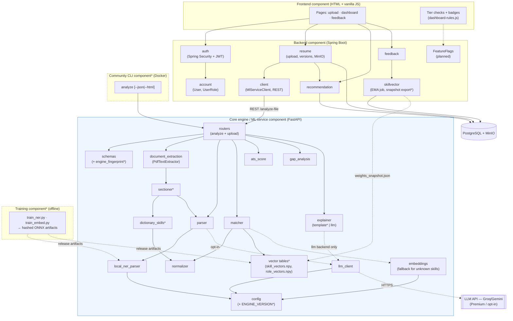

# UML diagrams: index

The UML documentation is split into one file per diagram type so each diagram stays readable. This page indexes them and also holds the one diagram with no other home, the component diagram.

| Diagram type | Where | What it shows |
|---|---|---|
| Use case diagram | [use-case-diagram.md](use-case-diagram.md) | Actors, use cases, implemented vs. planned |
| Class diagram | [class-diagram.md](class-diagram.md) | Pydantic models + services, backend JPA entities |
| Entity-relationship diagram | [entity-diagram.md](entity-diagram.md) | Conceptual/logical data model |
| Sequence diagram | [lld.md §3](lld.md#3-sequence-diagram-post-analyze-file-target-after-steps-13) | Call sequence for `POST /analyze` |
| Activity diagrams | [process-flow.md](process-flow.md) | User-journey flows with decision points |
| Component diagram | This page, §1 | Deployable/importable units and their dependencies |
| Deployment diagram | [architecture.md §5](architecture.md#5-deployment-view) | Container deployment per edition |
| Editions diagram | [editions-and-parity.md §1](editions-and-parity.md#1-the-promise-and-how-it-is-kept) | One core engine, three editions |

## 1. Component diagram

Import-time dependencies between components. This sits one level below the architecture diagram's boxes and network calls, and one level above the class diagram. Dashed borders mark planned components.

`*` marks a planned component. [Editions & Parity §7](editions-and-parity.md#7-implementation-order) lists the step that adds each one.

## 2. Reading order for reviewers new to the project

1. [SRS v2.0](srs.md): what the system must do, per edition
2. [Abstraction Overview](abstraction-overview.md): why it is built this way
3. [System Architecture](architecture.md) and [Editions & Parity](editions-and-parity.md): the overall shape
4. [HLD](hld.md): layer responsibilities
5. [Use Case Diagram](use-case-diagram.md): user-facing scope
6. [DFD](dfd.md) and [Process Flow](process-flow.md): behaviour
7. [Entity Diagram](entity-diagram.md) and [Database Schema](database-schema.md): data model
8. [Class Diagram](class-diagram.md) and [Entities & Fields](entities-and-fields.md): implementation-level structure
9. [LLD](lld.md): API contracts and module detail, grounded in the real code
10. [Datasets](datasets.md): what to test and train on

## Related documents

- [Tech Stack](tech-stack.md)
- [Index](index.md)
