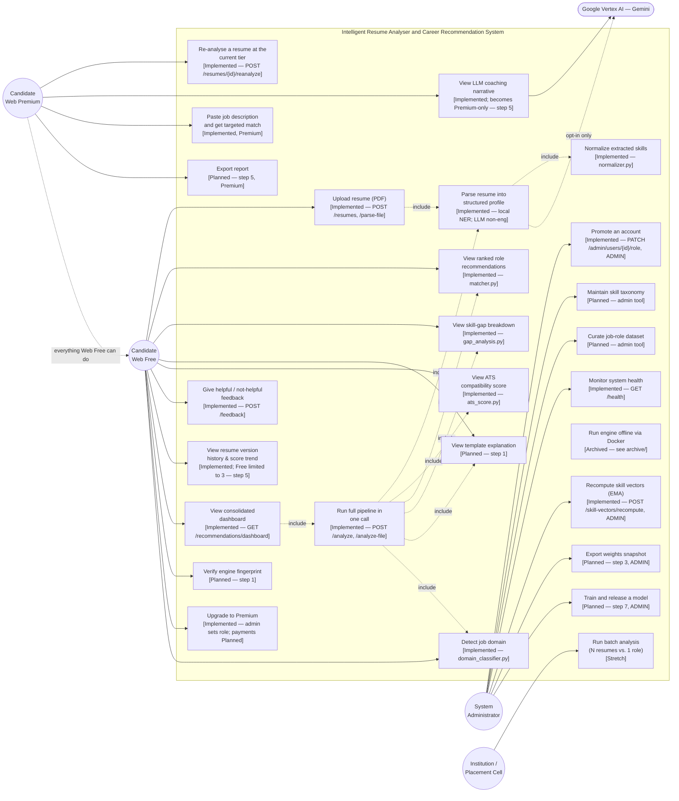

# Use case diagram

Actors and use cases per [SRS v2.0](srs.md) §2.3 (user classes) and §3 (functional requirements). Each use case is tagged [Implemented] when it exists as working code today, or [Planned] with the implementation step from [Editions & Parity §7](editions-and-parity.md#7-implementation-order).

## Actors

| Actor | Description |
|---|---|
| Candidate on Web Free (primary) | Job-seeking fresher or early-career professional. Uses the hosted app on GCP with an account; keeps the three most recent resume versions. |
| Candidate on Web Premium | Same person after upgrading: LLM coaching narrative, live-learned weights, unlimited history, exports. |
| Self-hosting user, Community Edition (archived) | Archived. This user was going to run the Docker image on their own machine ([details](archive/community-edition.md)). |
| System Administrator | Maintains taxonomy and role dataset, recomputes and exports skill-weight snapshots, manages cloud training, monitors health. |
| Institution / Placement Cell (future) | Batch analysis of many candidates against one role (stretch). |
| Google Vertex AI (Gemini 2.5 Flash Lite) (cloud service) | Invoked for the Premium coaching narrative (UC6b) and for non-engineering domain extraction (UC2). Never initiates action; never affects a score. |

## Diagram

## Use case detail (primary flows)

### UC4/UC5/UC6a/UC8/UC12: "Analyze my resume" (core flow)
- Actor: any candidate (Cloud Web Free / Cloud Web Premium).
- Precondition: a PDF resume uploaded through the web interface.
- Main flow: text extraction → section segmentation → dictionary + NER extraction → normalization → vector-table matching → ATS rules → template explanation → response with `engine_fingerprint`.
- Postcondition: results are shown, and the web platform stores the `Resume`, `ParsedProfile` and `Recommendation` rows.
- Requirements: FR-1.x, FR-3.x, FR-4.x, FR-5.4, FR-9.x, FR-11.2.

### UC6b: "Get an LLM coaching narrative" (Premium)
- Actor: Premium candidate.
- Main flow: after the core flow, the backend calls the ML service with `explainer=llm`; Google Vertex AI (Gemini) turns the already-computed numbers into prose. The base score is unchanged; the narrative is labelled non-deterministic.
- Requirements: FR-5.1 to 5.4, FR-12.2.

### UC17/UC18: "Core Engine Result Parity & Fingerprint Verification"
- Actor: candidate / auditor / administrator.
- Main flow: the returned `engine_fingerprint` can be checked against `GET /health` on the deployment. A matching fingerprint verifies that the models, vectors and weights are the same (FR-11.3). The standalone offline CLI is archived in [Archived: Community Edition](archive/community-edition.md).
- Requirements: FR-11.1 to 11.6, NFR-3.2, NFR-8.x.

### UC9 → UC21 → UC22: "Feedback improves the next release"
- Actors: candidate, then administrator.
- Main flow: feedback is saved with the active `SkillVector` version (FR-10.2). Once a role passes the feedback threshold, the EMA job writes a new weight version (FR-7.2 to 7.4). The administrator then exports a weights snapshot (FR-7.5), which ships inside the next core-engine release to every edition.

### UC7: "Match against a specific job description" (implemented, Premium)
- `POST /resumes/{id}/jd-match` (PREMIUM_USER/ADMIN): JD skills are dictionary matches against both taxonomies; score = 0.6 × coverage + 0.4 × embedding similarity; matched/missing lists and the closest catalogue role; deterministic, no LLM, nothing persisted. FR-8.1 and 8.2.

### UC13/UC14: admin taxonomy and dataset curation (planned)
- Today these are static JSON files. The plan is to make them DB-backed and editable without a deployment (FR-2.3), and later ESCO-based.

## Related documents

- [Data Flow Diagram](dfd.md)
- [Process Flow](process-flow.md)
- [Low-Level Design](lld.md): the API contracts behind each implemented use case
- [SRS v2.0](srs.md)
